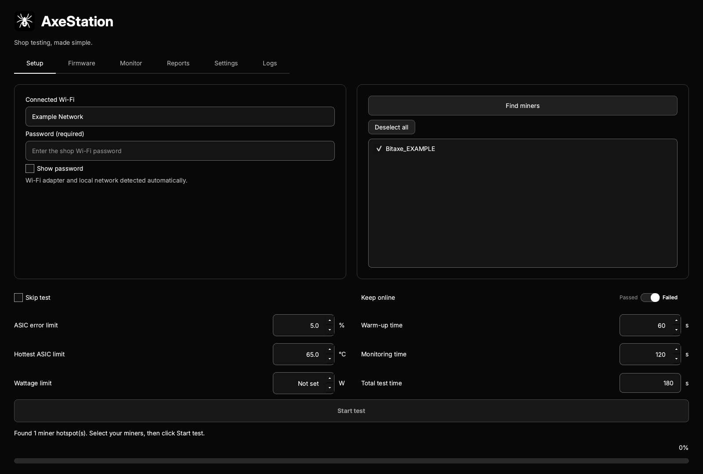
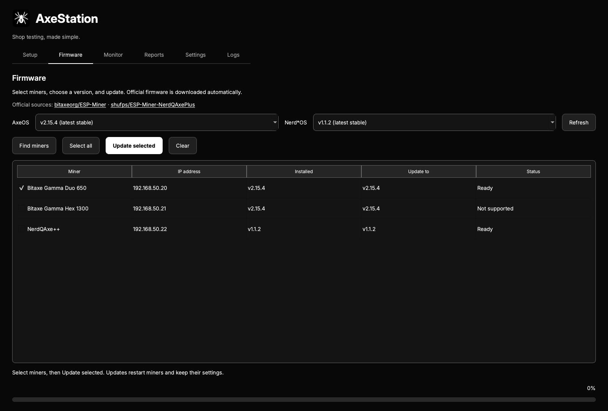
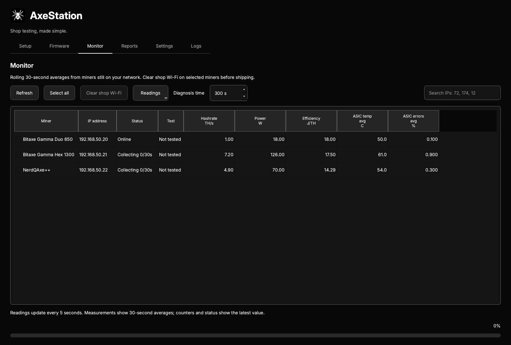

# AxeStation

**Shop testing, made simple.** Connect, test, monitor and update up to 25 Bitaxe
and Nerdaxe miners from one desktop app.

Made by [Solo Satoshi](https://www.solosatoshi.com/).

## Download

| Windows | Mac |
| :--- | :--- |
| **[Download for Windows x64](https://github.com/SoloSatoshi/AxeStation-Downloads/releases/download/v1.4.0/AxeStation-1.4.0-Windows-x64.zip)** | **[Download for Apple Silicon](https://github.com/SoloSatoshi/AxeStation-Downloads/releases/download/v1.4.0/AxeStation-1.4.0-macOS-AppleSilicon.zip)** |
| Windows 10 or 11, 64-bit | macOS 13 or later, M-series Mac |
| Extract the entire ZIP, then open `AxeStation.exe`. Keep the folder together. | Extract the ZIP, then move `AxeStation.app` to Applications. |

**Version 1.4.0** · [All releases, checksums and manifests](https://github.com/SoloSatoshi/AxeStation-Downloads/releases)

Windows binaries are unsigned. The Mac application is ad-hoc signed and is not
Apple notarized. Your operating system may require explicit approval to open it.
Use the official downloads above.

## Start here

1. Connect your computer to the Wi-Fi network your miners should use.
2. Open AxeStation and enter the network password. The network name fills automatically.
3. Power on miners in setup mode. Click **Find miners**, then select the miners.
4. Choose the limits and times. Click **Start test**, or select **Skip test** to connect only.
5. Review the PDF in **Reports**. Use **Monitor** for live readings and diagnosis.

Setup briefly connects the computer to each miner's hotspot, then returns to your
network. Internet access pauses during those switches unless another connection
is available. Allow Wi-Fi, location and local-network permissions when requested.
Location permission lets the operating system reveal Wi-Fi names; AxeStation
does not collect location coordinates.

## One workspace, six tabs

| Tab | What it does |
| --- | --- |
| Setup | Connect miners, set acceptance limits and choose warm-up and monitoring time. |
| Firmware | Match devices to official AxeOS or Nerd*OS releases and update selected miners over OTA. |
| Monitor | View 30-second averages, search multiple IPs, clear shop Wi-Fi and diagnose retained failed miners. |
| Reports | Review pass/fail reasons, open the batch test PDF or individual diagnostic PDFs. |
| Settings | Choose preferences, check for application updates and find license information. |
| Logs | Inspect and copy the current session's troubleshooting log. |

**Keep online** defaults to **Failed**: failing miners stay connected for
troubleshooting, while passing miners have shop Wi-Fi cleared. Select **Passed**
to reverse this. Incomplete or stopped tests remain online. Clearing shop Wi-Fi
does not erase pool settings or tuning and is not a full factory reset.

Default tests use 60 seconds of warm-up and 120 seconds of monitoring. ASIC
errors are judged by their average; hottest ASIC temperature and optional power
limits use the highest reported reading. Hardware and protection faults also
fail the test. Missing measurements are shown as unavailable, never invented.

Diagnostics collect one device's overall and per-chip performance for a chosen
duration. Open **View live** to follow the charts; closing the viewer leaves the
capture running. Each capture produces its own PDF. Chip temperatures appear
only when the firmware actually reports them.

## Screenshots

These screens use simulated miners and example network details.

### Setup

### Firmware

### Monitor

## Application updates

AxeStation checks for releases at startup and every six hours. You can also use
**Settings > Check for updates**. Choose **Update now** to download and verify the
signed release. Installation waits for active tests, captures and firmware work
to finish, then restarts the application. The previous app is retained until the
new app acknowledges startup. Save any session logs you need before updating.

Install in a writable application folder. Protected system folders may require a
manual install with operating-system approval. Versions before 1.4.0 need one
manual upgrade before they can use in-app updates.

Application updates are separate from miner firmware updates. Firmware downloads
come from [bitaxeorg/ESP-Miner](https://github.com/bitaxeorg/ESP-Miner) and
[shufps/ESP-Miner-NerdQAxePlus](https://github.com/shufps/ESP-Miner-NerdQAxePlus).
Model matching and API compatibility checks do not replace testing each physical
board and its power supply.

## Privacy, licenses and help

Every launch starts a fresh session. Passwords, selections, discovered miners,
logs and temporary caches are discarded on normal exit. Exported PDFs remain.
Application release checks and firmware downloads contact their public servers;
there is no analytics service or cloud account.

- [Privacy](PRIVACY.md)
- [Application terms](LICENSE.txt)
- [Third-party licenses and corresponding sources](THIRD-PARTY.md)
- [Replacing open-source libraries](open-source/REPLACING-LIBRARIES.md)
- [Security contact](SECURITY.md)
- [Solo Satoshi](https://www.solosatoshi.com/)

This repository contains official downloads, update metadata, documentation and
third-party license materials. The original AxeStation application source is
maintained separately and is proprietary.
